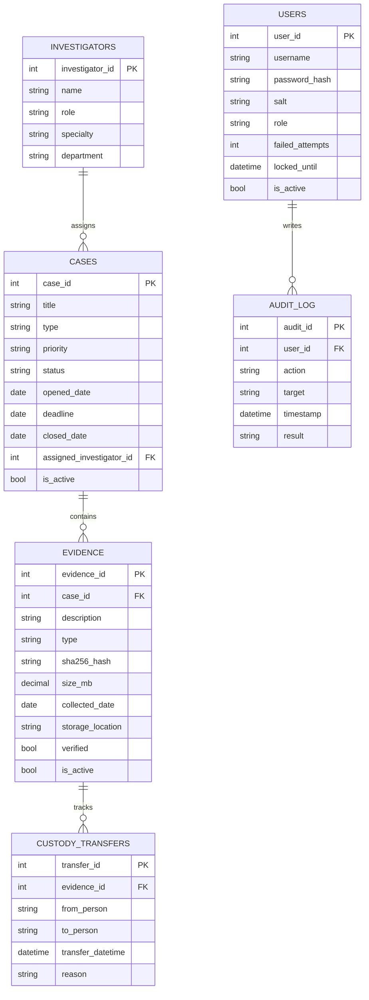
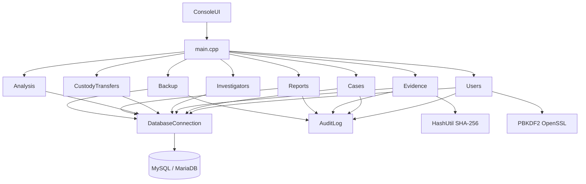

# SecureTrace

Digital Evidence & Case Management System for UTeM, Faculty of AI and Cyber Security. Defensive record-keeping only: cases, evidence, investigators, chain of custody, users, analysis, and reports.

## Setup

### Prerequisites

- C++17 compiler (g++ or MSVC)
- CMake 3.16+
- MySQL 8 or MariaDB 10.4+
- MySQL Connector/C++ (JDBC/classic, `mysql_driver.h`)
- OpenSSL (libssl / libcrypto)

### Database

```sql
SOURCE sql/schema.sql;
SOURCE sql/create_app_user.sql;
SOURCE sql/seed.sql;
```

If the database was created in Phase 1, also run `sql/alter_phase2.sql` once.

Copy `config/config.example.ini` to `config/config.ini` and set the password to match `create_app_user.sql` (`ChangeMe_AppUser_1` by default).

### Demo accounts

| Username | Password    | Role          |
|----------|-------------|---------------|
| admin    | Admin@123   | admin         |
| nurul    | Invest@123  | investigator  |
| viewer   | Viewer@123  | viewer        |

### Build (Windows)

```
build.bat
```

or:

```
cmake -S . -B build -G "Visual Studio 17 2022" -A x64 ^
  -DMYSQL_CONNECTOR_DIR="C:\path\to\mysql-connector-c++" ^
  -DOPENSSL_ROOT_DIR="C:\Program Files\OpenSSL-Win64"
cmake --build build --config Release
```

Copy `mysqlcppconn*.dll` next to the executable. Run from a folder that contains `config/`.

```
securetrace.exe
securetrace.exe --help
securetrace.exe --demo
```

### Build (Linux)

```
chmod +x build.sh
./build.sh
./build/securetrace
./build/securetrace --help
./build/securetrace --demo
```

### Security tests

```
./build/securetrace_tests
```

or on Windows: `build\Release\securetrace_tests.exe` from a working directory that can load `config/config.ini`.

## ER diagram



## Data dictionary

| Table | Column | Type | Notes |
|-------|--------|------|-------|
| investigators | investigator_id | INT PK | Auto increment |
| investigators | name, role, specialty, department | VARCHAR | Required |
| cases | case_id | INT PK | Auto increment |
| cases | title | VARCHAR(150) | |
| cases | type | VARCHAR | Fraud / Data Breach / Insider Threat / Malware / Other |
| cases | priority | VARCHAR | Low / Medium / High / Critical |
| cases | status | VARCHAR | Open / In Progress / Closed |
| cases | opened_date, deadline, closed_date | DATE | closed_date required iff Closed |
| cases | assigned_investigator_id | INT FK | investigators |
| cases | is_active | TINYINT | Soft delete |
| evidence | evidence_id | INT PK | |
| evidence | case_id | INT FK | cases |
| evidence | sha256_hash | CHAR(64) | Hex SHA-256 |
| evidence | size_mb | DECIMAL(10,2) | Must be > 0 |
| evidence | verified, is_active | TINYINT | Integrity flag / soft delete |
| custody_transfers | transfer_id | INT PK | Append-only |
| custody_transfers | evidence_id | INT FK | |
| custody_transfers | from_person, to_person, reason | VARCHAR | |
| custody_transfers | transfer_datetime | DATETIME | |
| users | user_id | INT PK | |
| users | username | VARCHAR(32) | Unique |
| users | password_hash, salt | CHAR | PBKDF2-HMAC-SHA256 |
| users | role | VARCHAR | admin / investigator / viewer |
| users | failed_attempts, locked_until, is_active | | Lockout after 3 fails |
| audit_log | audit_id | INT PK | Append-only |
| audit_log | user_id | INT FK | Nullable |
| audit_log | action, target, result | | SUCCESS / FAIL |

## Structured chart (modules)



## Test cases

| ID | Test | Expected |
|----|------|----------|
| T1 | Login admin / Admin@123 | Success, full menu |
| T2 | Login nurul / Invest@123 | Investigator menu only |
| T3 | Login viewer / Viewer@123 | Summary reports + analysis (masked) |
| T4 | 3 wrong passwords | Account locked 5 minutes |
| T5 | Login `' OR '1'='1` | Rejected, users table intact |
| T6 | Case deadline before opened_date | Rejected |
| T7 | Close case with unverified evidence | Investigator blocked; admin override logged |
| T8 | Evidence create from file/text | SHA-256 stored |
| T9 | Verify same source / different source | Match / mismatch + HASH_VERIFY |
| T10 | Custody on inactive evidence | Rejected |
| T11 | Custody Update/Delete | Not on menu |
| T12 | Viewer opens Users / Backup | Access denied |
| T13 | Analysis 6 named features | Tables with one-line explanations |
| T14 | Reports 1,4,5 as viewer | Visible; 2,3,6 hidden |
| T15 | Export report TXT+CSV | `reports/<slug>_timestamp.*` and REPORT_EXPORT |
| T16 | Admin backup | `reports/backups/backup_*` CSV+SQL |
| T17 | `securetrace_tests` | All PASS |
| T18 | Success/error lines are coloured (or plain if the terminal has no colour) | Visible [OK]/[ERROR]/[WARN] |
| T19 | Long table cells truncated; 10 rows per page; n/p pages | Cases → List all |
| T20 | Status bar shows user, role, time | After login, main menu |
| T21 | 0 or b goes back; c cancels a form field | Any menu / Create form |
| T22 | y/n before delete or close | Cases → Delete; Cases → Update → Closed |
| T23 | Bad number/date re-prompts; leading spaces trimmed | Type ` 12 ` or `abc` at an ID prompt |
| T24 | Case/evidence search by keyword; list sort/filter | Cases → Search / List all |
| T25 | Dashboard after login: open, overdue, unverified, last login | Login then dashboard |
| T26 | Report preview, then export; path printed; today/week/month/custom | Reports → any → export |
| T27 | Admin restore soft-deleted case/evidence | Cases/Evidence → Restore inactive |
| T28 | Missing config.ini or stopped MySQL | Friendly startup message |
| T29 | `securetrace --demo` | Reloads schema.sql + seed.sql |
| T30 | Welcome → Help / About, or `--help` | Help and About screens |

Automated tests T4, T5, T12, T9-style hash mismatch: run `securetrace_tests`.

## Requirements mapping

| Requirement | Where implemented | Menu path |
|-------------|-------------------|-----------|
| 5 CRUDS modules | `src/Cases.cpp`, `Evidence.cpp`, `Investigators.cpp`, `CustodyTransfers.cpp`, `Users.cpp` | Cases / Evidence / Investigators / Custody Transfers / User Management |
| Custody append-only | `src/CustodyTransfers.cpp` (Create/Read/Search only) | Custody Transfers |
| Soft delete | `cases.is_active`, `evidence.is_active`, users disable | Cases → Delete; Evidence → Delete; Users → Disable |
| SHA-256 create + verify | `include/HashUtil.h`, `src/Evidence.cpp` | Evidence → Create / Verify integrity |
| Close override | `src/Cases.cpp` | Cases → Update → Closed |
| AGGREGATION | `src/Analysis.cpp` `aggregation()` | Analysis & Calculations → AGGREGATION |
| GROUPING | `src/Analysis.cpp` `grouping()` | Analysis → GROUPING |
| JOIN | `src/Analysis.cpp` `joinOps()` | Analysis → JOIN |
| SUBQUERY | `src/Analysis.cpp` `subquery()` | Analysis → SUBQUERY |
| UNARY COUNT/MAX/MIN | `src/Analysis.cpp` `unaryCount/Max/Min` | Analysis → A. UNARY |
| GROUPING COUNT/SUM/AVG/HAVING | `src/Analysis.cpp` grouping* | Analysis → B. GROUPING |
| DECISION SUPPORT | `src/Analysis.cpp` decision* | Analysis → E. DECISION SUPPORT |
| Dashboard | `src/main.cpp` `showDashboard` | After login / Main → Dashboard |
| Restore soft-delete | `src/Cases.cpp` `restore`, `src/Evidence.cpp` `restore` | Cases/Evidence → Restore inactive |
| Help / About / --demo | `src/main.cpp` | Welcome → Help/About; `securetrace --demo` |
| Report tables | `src/Reports.cpp` `buildCaseStatus` | Reports → Case status summary |
| Summary lists | `src/Reports.cpp` `buildSummaryLists` | Reports → Summary lists |
| Custody timeline | `src/Reports.cpp` `buildCustody` | Reports → Chain-of-custody timeline |
| Text bar chart | `src/Reports.cpp` `buildTypeChart` | Reports → Bar chart |
| Text trend | `src/Reports.cpp` `buildMonthlyTrend` | Reports → Trend |
| Audit report | `src/Reports.cpp` `auditReport` | Reports → Audit log / Main → Audit Log |
| Export TXT/CSV | `src/Reports.cpp` `offerExport` | After any report → Export |
| Viewer masking | Analysis + Reports + Evidence fields | Viewer Summary Reports |
| PBKDF2 + salt | `src/Users.cpp` | Login / User Management → Create |
| Lockout 3 fails / 5 min | `src/Users.cpp` `recordFailedLogin` | Login |
| RBAC | `Users::hasPermission`, each module `deny()` | All menus |
| Session timeout 10 min | `src/main.cpp` | Automatic |
| Prepared statements | `DatabaseConnection::prepare` everywhere | All queries |
| Audit log + triggers | `sql/schema.sql`, `src/AuditLog.cpp` | Automatic |
| Least-privilege DB user | `sql/create_app_user.sql` | Connection |
| Security tests | `tests/security_tests.cpp` | `securetrace_tests` |
| Admin backup | `src/Backup.cpp` | Backup / Export |
